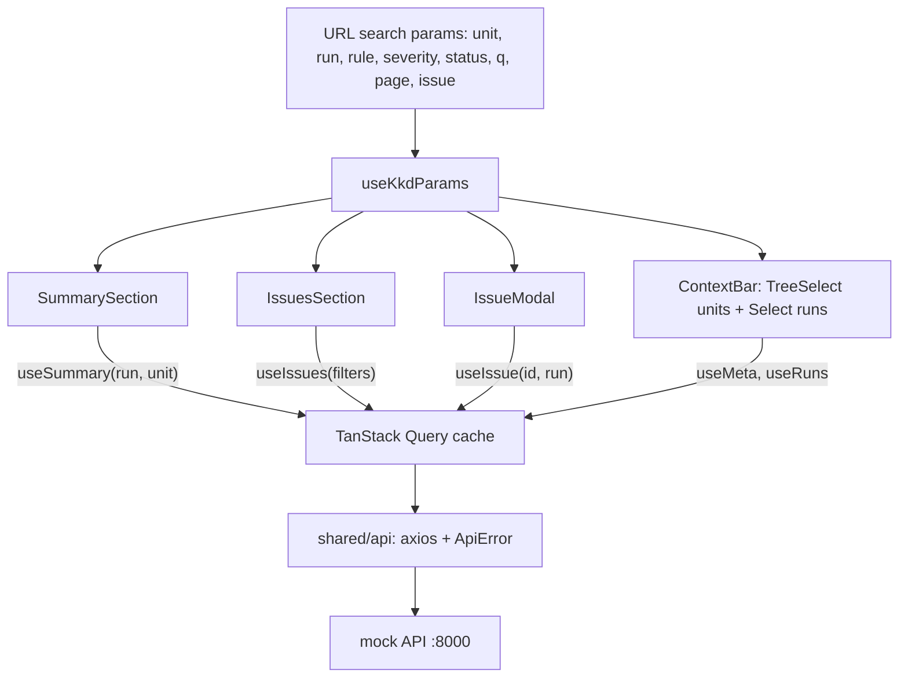

# Дизайн: страница модуля ККД

Что должно получиться и как это проверяется — в [`requirements.md`](requirements.md). Здесь — модель данных, API, состояние в URL, кеш, правила дельты, структура кода и ключевые решения. Контракт API взят из [`backend/app/main.py`](../backend/app/main.py) и `backend/app/store.py`; типы — в [`src/shared/api/types.ts`](../src/shared/api/types.ts).

## 1. Архитектура



В Docker запросы идут `браузер → nginx :8080 → /api → backend:8000`; в dev — `браузер → Vite :5173 → /api → VITE_API_PROXY_TARGET`. Благодаря этому у API один адрес с точки зрения браузера (относительный `/api`), и CORS не нужен.

## 2. Модель данных

Типы описаны в `src/shared/api/types.ts` и повторяют ответы API без преобразований. Поля `snake_case` сохранены как в API; в `IssuesQuery` и `SummaryQuery` параметры запроса описаны в `camelCase` и переводятся в `snake_case` на уровне `endpoints.ts`.

| Тип | Ключевые поля | Примечания |
|---|---|---|
| `MetaResponse` | `units[]`, `rules[]`, `severities[]`, `goal_levels[]`, `metrics[]`, `delta_statuses[]` | Справочники. `units[]`: `id`, `name`, `level`, `parent_id`, `depth`. `severities[].order` — чем меньше, тем важнее. |
| `Run` | `id` (`RUN-008`), `number`, `status` (`completed` / `failed` / `running`), `trigger`, `snapshot_date`, `started_at`, `finished_at`, `compared_to_run_id`, `error`, `totals?` | `error` заполнен только у `failed`. `compared_to_run_id` равен `null` у первого прогона. |
| `SummaryResponse` | `run`, `compared_to`, `unit` (с `path[]`), `metrics[]`, `issues_by_severity[]`, `issues_by_rule[]`, `delta` | `compared_to` равен `null` у первого прогона. |
| `MetricRow` | `key`, `title`, `unit` (`%` / `шт.`), `higher_is_better`, `formula`, `value`, `previous`, `delta`, `delta_pct`, `trend` | `value`, `previous`, `delta`, `delta_pct`, `trend` и `higher_is_better` могут быть `null`. `metrics` — **массив строк**, а не объект по кодам. |
| `SeverityRow`, `RuleRow` | `code`, `title`, `current`, `previous`, `delta` (+ `severity`, `object_type` у правил) | `previous` и `delta` равны `null` у первого прогона. |
| `DeltaCounters` | `new`, `persisting`, `resolved` | Каждое значение `number \| null`; у первого прогона все `null`. |
| `Issue` | `id`, `rule_code`, `rule_title`, `severity`, `object_type`, `object_id`, `goal_*`, `kr_*`, `unit_id`, `unit_name`, `owner`, `details`, `actual`, `expected`, `recommendation`, `delta_status`, `first_detected_run_id`, `first_detected_at`, `runs_in_row` | `owner` может быть `null`. `actual` и `expected` — `string \| number \| null`. У `resolved`: `first_detected_*` и `runs_in_row` равны `null`. |
| `IssueDetail` | `Issue` + `history[]` | `history[]`: `run_id`, `snapshot_date`, `run_status`, `present: boolean \| null`. |
| `Paginated<T>` | `items`, `total`, `limit`, `offset` | Основа `IssuesResponse` (плюс `run_id`) и `RunsResponse`. |
| `ApiError` | `code`, `message`, `status` | Единый вид ошибки для UI (см. раздел 7). |

Ключи метрик (`MetricKey`): `clean_goals_share`, `goals_active`, `key_results`, `goals_with_issues`, `issues_total`, `critical_issues`, `cascade_coverage`, `kr_completeness`, `avg_kr_per_goal`. Метрика `avg_kr_per_goal` имеет `higher_is_better: null` — оценки «лучше / хуже» для неё нет.

## 3. Используемые эндпоинты

Все запросы идут через `apiClient` (axios) с `baseURL = VITE_API_URL ?? ''`. Таймаут 30 с. В каждый запрос передаётся `AbortSignal` из TanStack Query.

| Метод и путь | Параметры | Где используется | Ошибки |
|---|---|---|---|
| `GET /api/meta` | — | `useMeta`: дерево подразделений, правила, важности, метки статусов | — |
| `GET /api/runs` | `limit=100`, `offset` | `useRuns`: список прогонов (от новых к старым), прогон по умолчанию, причина ошибки | — |
| `GET /api/kkd/summary` | `run_id`, `unit_id` | `useSummary`: метрики, разбивки, счётчики, `compared_to` | 409 `RUN_FAILED` / `RUN_IN_PROGRESS`, 404 `RUN_NOT_FOUND` / `UNIT_NOT_FOUND` |
| `GET /api/kkd/issues` | `run_id`, `unit_id`, `rule_code` (CSV), `severity` (CSV), `delta_status` (CSV), `q`, `sort`, `limit`, `offset` | `useIssues`: страница таблицы | те же, плюс 400 `INVALID_PARAM` |
| `GET /api/kkd/issues/{id}` | `run_id` | `useIssue`: карточка и история | 404 `ISSUE_NOT_FOUND`, 409 `RUN_FAILED` |

Особенности контракта:

- Списочные фильтры уходят одним параметром через запятую (`rule_code=A,B`). Пустой список параметр не создаёт.
- `delta_status=resolved` — единственный способ получить исправленные проблемы: без явного фильтра API их не отдаёт.
- Размер страницы таблицы — 20 (`limit=20`, `offset = (page − 1) × 20`). Сортировка по умолчанию — `severity`, её задаёт API.
- Задержка mock API — 300 мс (`MOCK_LATENCY_MS`), чтобы были видны состояния загрузки.
- Остальные эндпоинты mock API (`/kkd/units`, `/kkd/trend`, `/kkd/issues/export`, `/goals`) решению не нужны.

## 4. Состояние в URL

Всё состояние страницы хранится в query-параметрах URL; единственный источник правды — хук `useKkdParams` поверх `useSearchParams` из React Router. Локального дублирующего состояния нет.

| Параметр | Значение | По умолчанию | Примечания |
|---|---|---|---|
| `unit` | `unit_id`, например `CIB-REG` | корневое подразделение из `meta.units` (`parent_id === null`) | Смена сбрасывает `page` и `issue`. |
| `run` | `run_id`, например `RUN-008` | первый `completed` из `/api/runs` | Смена сбрасывает `page` и `issue`. Выбрать можно и `failed`. |
| `rule` | коды правил через запятую | не задан | Смена сбрасывает `page`. |
| `severity` | `critical`, `major`, `minor` через запятую | не задан | Смена сбрасывает `page`. |
| `status` | `new`, `persisting`, `resolved` через запятую | не задан | Клик по счётчику сводки задаёт этот параметр. Смена сбрасывает `page`. |
| `q` | строка поиска | не задан | Смена сбрасывает `page`. Запрос уходит с дебаунсом. |
| `page` | номер страницы, начиная с 1 | 1 | Значение по умолчанию в URL не пишется. |
| `issue` | `id` проблемы, например `ISS-1A2B3C4D5E` | не задан | Открывает модалку. Закрытие убирает параметр. |

Правила:

- В URL попадают только значения, отличные от значений по умолчанию, чтобы ссылки были короткими.
- Изменения фильтров делаются через `replace`, открытие модалки и смена контекста — через `push`, чтобы кнопка «Назад» закрывала модалку.
- Явные `unit` и `run` резолвятся один раз: если параметров нет, значения по умолчанию подставляются при чтении и в запросах всегда есть явные идентификаторы.

## 5. Ключи запросов и кеш

Все ключи собраны в одной фабрике `queryKeys` ([`src/shared/api/queryKeys.ts`](../src/shared/api/queryKeys.ts)) под корнем `['kkd']`:

| Ключ | Значение | Политика |
|---|---|---|
| `['kkd', 'meta']` | справочники | `staleTime: Infinity` |
| `['kkd', 'runs']` | список прогонов | `staleTime: Infinity` |
| `['kkd', 'summary', { runId, unitId }]` | сводка | по умолчанию; `skipToken`, пока нет `runId` или `unitId` |
| `['kkd', 'issues', query]` | страница проблем; `query` включает контекст, фильтры, `limit`, `offset` | `placeholderData: keepPreviousData` |
| `['kkd', 'issue', { issueId, runId }]` | карточка | `skipToken`, пока нет `issueId` или `runId` |

Решения:

- **Явный id прогона вместо `latest`.** Прогон по умолчанию вычисляется из закешированного списка прогонов (`selectDefaultRun`). В кеше не появляется двух ключей для одних и тех же данных (`latest` и `RUN-008`), а URL однозначно воспроизводит состояние.
- **Справочники грузятся один раз.** `meta` и `runs` не меняются за сессию, поэтому `staleTime: Infinity`. Прогон по умолчанию берётся через `select` из того же запроса `runs`, без отдельного запроса.
- **Таблица не мигает.** `keepPreviousData` оставляет прежнюю страницу на экране, пока грузится новая; признак `isPlaceholderData` включает `loading` таблицы.
- **4xx не повторяются.** Для ответов 4xx (в том числе 409 `RUN_FAILED`) `retry` отключён; сетевые ошибки и 5xx повторяются ограниченное число раз, затем показывается `ErrorState` с кнопкой «Повторить» (`refetch`).
- **Отмена запросов.** `AbortSignal` из контекста запроса передаётся в axios; устаревший запрос при смене параметров отменяется.
- **Независимые секции.** Сводка, таблица и модалка — отдельные запросы; ошибка в одной не влияет на другие.

## 6. Правила дельты

Компонент `DeltaIndicator` ([`src/shared/ui/`](../src/shared/ui/)) — единственное место, где дельта превращается в текст и цвет. Он не считает ничего: берёт `delta`, `delta_pct`, `previous`, `trend` из ответа. Направление числа (стрелка вверх или вниз) определяется **знаком `delta`**, оценка («лучше / хуже») и цвет — **полем `trend`**. Поэтому рост числа проблем с `trend = worse` рисуется красной стрелкой вверх с подписью «хуже», а рост доли корректных целей с `trend = better` — зелёной стрелкой вверх с подписью «лучше».

| `previous` | `delta` | `trend` | `higher_is_better` | Что показываем | Цвет |
|---|---|---|---|---|---|
| `null` | `null` | `null` | любое | «нет данных для сравнения»; ноль не показывается | `colorTextTertiary` |
| не `null` | `0` | `same` | `true` / `false` | значок «−» (не стрелка), «без изменений» | `colorTextSecondary` |
| не `null` | `> 0` | `better` | `true` | стрелка вверх, `+delta`, «лучше» | `colorSuccess` |
| не `null` | `> 0` | `worse` | `false` | стрелка вверх, `+delta`, «хуже» | `colorError` |
| не `null` | `< 0` | `better` | `false` | стрелка вниз, `delta`, «лучше» | `colorSuccess` |
| не `null` | `< 0` | `worse` | `true` | стрелка вниз, `delta`, «хуже» | `colorError` |
| не `null` | `≠ 0` | `null` | `null` | стрелка по знаку, `delta`, **без оценки** | `colorTextSecondary` |
| не `null` | любая | любая | любое | если `delta_pct` не `null` — рядом показывается процент как есть; при `null` (например, `previous = 0`) процент скрыт | — |

Дополнительно:

- `value === null` (TX-NEW): карточка показывает «—» и подпись «нет данных», а не 0.
- Единицы форматируются по `unit`: `%` для долей (дельта в долях — «п.п.»), `шт.` для количеств. Числа и даты форматируются в локали `ru-RU` ([`src/shared/lib/format.ts`](../src/shared/lib/format.ts)), значения не округляются сверх отображения.
- `aria-label` содержит полную фразу: «Снизилось на 4,3 п.п. относительно RUN-007 — хуже». Для «нет данных» компонент выводит обычный текст «нет данных для сравнения».
- Подпись «с чем сравниваем» (`compared_to`) всегда видна в контексте страницы; `DeltaIndicator` использует её в `aria-label`.
- У счётчиков `new / persisting / resolved` значение `null` означает «нет сравнения» (RUN-001), а не 0.

Цвета важности и статуса дельты (из UI-KIT; везде рядом слово и значок):

| Сущность | Значение | Цвет и фон |
|---|---|---|
| Важность | `critical` | `colorError` |
| Важность | `major` | `colorWarning` |
| Важность | `minor` | `colorTextSecondary` |
| Статус дельты | `new` | фон `colorErrorBg` |
| Статус дельты | `persisting` | фон `colorFill` |
| Статус дельты | `resolved` | фон `colorSuccessBg` |

## 7. Обработка ошибок

`src/shared/api/errors.ts` приводит любую ошибку запроса к `ApiError { code, message, status }`:

- ответ вида `{ error: { code, message } }` → `code` и `message` из ответа, `status` из HTTP;
- ответ FastAPI `{ detail: [...] }` со статусом 422 → `VALIDATION_ERROR`;
- нет ответа (обрыв, таймаут, CORS) → `NETWORK_ERROR` с понятным русским сообщением, `status = null`;
- остальное → `UNKNOWN_ERROR`.

Предикаты `isRunFailed`, `isRunInProgress`, `isNetworkError`, `isNotFound`, `isClientError`, `isRetryable` определяют, что показать:

| Ситуация | Предикат | Показываем | Повтор запроса |
|---|---|---|---|
| Неуспешный прогон | `isRunFailed` | блок с `run.error` и кнопкой «Открыть последний успешный прогон» | нет |
| Прогон ещё выполняется | `isRunInProgress` | сообщение «Прогон ещё выполняется» | нет |
| Нет ответа или 5xx | `isRetryable` | `ErrorState` с кнопкой «Повторить» | автоматические повторы, затем вручную |
| 404 по проблеме | `isNotFound` | сообщение внутри модалки | нет |
| Остальные 4xx | `isClientError` | `ErrorState` с текстом ошибки | нет |

Правило: ошибка секции показывается в пределах этой секции; страница в целом не падает.

## 8. Структура папок

```text
src/
├── app/
│   ├── App.tsx            # роутер и страница
│   ├── providers.tsx      # QueryClient, единственный ConfigProvider, antd App, патч React 19
│   └── theme.ts           # тема из UI-KIT + семантические токены
├── pages/kkd/
│   └── KkdPage.tsx        # только композиция секций
├── features/
│   ├── kkd-context/       # ContextBar, UnitTreeSelect, RunSelect, ComparisonCaption, useKkdParams
│   ├── kkd-summary/       # SummarySection, VerdictPanel, MetricCard, DeltaCounters, IssuesBreakdown
│   └── kkd-issues/        # IssuesSection, IssuesFilters, IssuesTable, IssueModal, IssueHistory
└── shared/
    ├── api/               # client, errors, types, endpoints, queryKeys, hooks
    ├── ui/                # DeltaIndicator, SeverityTag, DeltaStatusTag, ErrorState, SlowLoadingHint
    └── lib/format.ts      # числа с единицей, даты ru-RU
```

Зависимости направлены вниз: `pages → features → shared`; `features` не импортируют друг друга, кроме общего `useKkdParams`.

## 9. Docker и окружение

- [`Dockerfile`](../Dockerfile): стадия `node:24-alpine` (`npm ci && npm run build`), затем `nginx:alpine` со статикой из `dist/`.
- [`nginx/default.conf.template`](../nginx/default.conf.template): `/api/` и `/health` проксируются на `${API_UPSTREAM}` без изменения пути; всё остальное — `try_files $uri $uri/ /index.html` (SPA fallback). Образ nginx сам подставляет переменные окружения в `*.template` при старте контейнера.
- [`docker-compose.yml`](../docker-compose.yml): `backend` (порт 8000) и `frontend` (порт 8080 → 80, `API_UPSTREAM=http://backend:8000`, `depends_on: backend: service_healthy`).
- `VITE_API_URL` читается при сборке; по умолчанию пуст, поэтому клиент ходит на относительный `/api`. Подробности — в [`.env.example`](../.env.example) и README.

## 10. Ключевые решения

| Решение | Почему |
|---|---|
| **Ant Design 5, а не 6.** Каркас был создан с antd 6; проект переведён на `antd@^5` и `@ant-design/icons@^5`. | Задание прямо требует Ant Design 5, а справочник UI-KIT и токены темы рассчитаны на него. Для React 19 подключён `@ant-design/v5-patch-for-react-19` (импорт в `providers.tsx`). Синтаксис antd 6 заменён на синтаксис 5 (например, `Space orientation` → `direction`). |
| **Явный `run_id`, а не `latest`.** | Один ключ кеша на один набор данных, воспроизводимый URL, нет расхождения между «последним» на момент загрузки и на момент клика. Прогон по умолчанию — первый `completed` из списка. |
| **Состояние страницы в URL, а не в React-состоянии.** | Ссылкой можно поделиться, «Назад» работает, смена параметров не требует перезагрузки, нет рассинхронизации между несколькими источниками правды. |
| **Никаких вычислений метрик на фронтенде.** | Требование задания и условие честности: дельта и оценка приходят из API. Фронтенд только выбирает подпись, цвет и стрелку. |
| **Оценка по `trend`, направление по знаку `delta`.** | Рост числа проблем — плохо, рост доли корректных целей — хорошо. Знак числа не равен оценке; `higher_is_better: null` — оценки нет вообще. |
| **`null` вместо нуля.** | Отсутствие сравнения (RUN-001) и отсутствие данных (TX-NEW) не выдаются за 0 ни в карточках, ни в счётчиках. |
| **Типы по реальному контракту.** | Каркас предполагал `metrics` как объект по кодам и `counters`; реальный API отдаёт массив строк и `delta: {new, persisting, resolved}` с `null`. Типы переписаны по `backend/app/main.py`. |
| **Серверные фильтры и пагинация.** | API фильтрует и считает `total`; клиент не держит весь набор и не фильтрует сам. |
| **Тема из токенов, цвета из `theme.useToken()`.** | Требование UI-кита: hex в компонентах запрещены. Недостающие семантические токены (`colorSuccessBg`, `colorErrorText` и т. д.) добавлены в `theme.ts`. |
| **nginx-прокси вместо прямых обращений к API из браузера.** | Один адрес и никакого CORS; адрес бэкенда задаётся `API_UPSTREAM` при запуске контейнера. |
